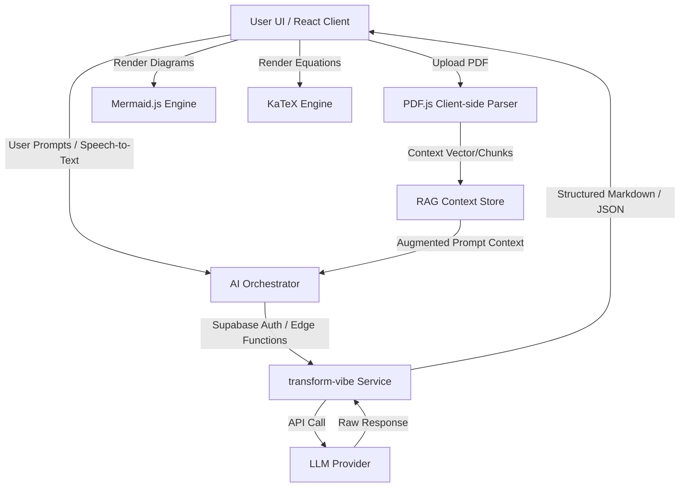

# 🎓 LearnAI: Adaptive AI Professor & Classroom Assistant

<div align="center">
  
  
  
  
  
</div>

---

**LearnAI** is a futuristic, AI-integrated educational platform designed to provide a highly personalized, adaptive learning experience. Powered by **Client-Side Retrieval-Augmented Generation (RAG)**, live transcription engines, and semantic grading algorithms, it serves as a comprehensive digital tutor and interactive classroom assistant.

---

## ✨ Key Features

### 👨‍🏫 1. Adaptive AI Professor
* **Contextual Tutoring**: Implements client-side RAG using PDF extraction, grounding all AI responses in the user's specific course materials rather than generic base-model training.
* **Educational Level Mapping**: Dynamically adjusts response complexity, lecturing tone, and vocabulary depending on the student's profile (School, College, or University level).
* **Multimodal Learning Outputs**: Generates customized lecture notes, flashcards, interactive study roadmaps, and conceptual diagrams on demand.

### 🎙️ 2. Futuristic Classroom Mode
* **Real-time Live Transcription**: Utilizes the browser's Web Speech API for hands-free, continuous lecture-to-text conversion.
* **Holographic Instant Q&A**: Automatically detects student questions in live spoken audio and outputs targeted answers instantly without interrupting the transcript flow.
* **Auto-Summarization**: Converts full-session classroom transcripts into structured, high-quality Markdown study summaries with one click.

### 📝 3. Interactive Quizzes & Assessments
* **Dynamic MCQs**: Generates custom multiple-choice quizzes with live interactive grading, visual feedback, and seed-based randomization to guarantee unique questions every run.
* **Semantic grading (Rapid Fire Mode)**: Evaluates short, text-based answers using a custom **Semantic Keyword Matching Algorithm** focusing on conceptual understanding and core keywords rather than rigid string matches.

### 📊 4. Academic Visualizations & Formulas
* **Dynamic Diagrams**: Renders interactive Flowcharts, Mindmaps, and Digital Logic Diagrams (DLD) directly from AI prompts using Mermaid.js.
* **Academic Formulating**: Employs LaTeX math notation beautifully rendered inside the browser via KaTeX.

---

## 🏗️ Architecture Flow



---

## 🛠️ Technology Stack

| Category | Technology | Purpose |
| :--- | :--- | :--- |
| **Frontend Core** | React 18, TypeScript, Vite | Fast, type-safe reactive interface build system |
| **Styling & UI** | Tailwind CSS, Shadcn/UI, Framer Motion | Modern styling, accessible primitives, and fluid animations |
| **Backend & Auth** | Supabase, PostgreSQL | Secure user authentication, profile storage, and relational data |
| **AI Runtime** | Supabase Edge Functions (Deno) | Serverless execution for AI orchestration and API secrecy |
| **Doc Processing** | PDF.js (configured via Local Worker) | Client-side text extraction from course PDFs |
| **Math & Diagrams** | Mermaid.js, KaTeX / React-KaTeX | Dynamic visualizations and publishing-quality math rendering |

---

## ⚙️ Setup & Installation

Follow these instructions to clone, configure, and boot the application locally:

### 1. Clone the Project
```bash
git clone https://github.com/YOUR_USERNAME/learn-ai.git
cd learn-ai
```

### 2. Install Dependencies
Ensure you have **Node.js (v18+)** installed:
```bash
npm install
```

### 3. Setup Environment Variables
Create a `.env` file in the root folder and configure your Supabase connection parameters:
```env
VITE_SUPABASE_URL=https://your-project-id.supabase.co
VITE_SUPABASE_ANON_KEY=your-anon-public-key
```

### 4. Deploy Supabase Edge Functions (AI Logic)
The core AI orchestration logic runs within a Supabase Edge Function named `transform-vibe`.
1. Install Supabase CLI locally:
   ```bash
   npm install supabase --save-dev
   ```
2. Authenticate and link your Supabase project:
   ```bash
   npx supabase login
   npx supabase link --project-ref your-project-id
   ```
3. Set your LLM Provider API Key (e.g., OpenAI API Key) inside Supabase Secrets:
   ```bash
   npx supabase secrets set OPENAI_API_KEY=sk-your-openai-key-here
   ```
4. Deploy the edge function:
   ```bash
   npx supabase functions deploy transform-vibe
   ```

### 5. Launch the Local Server
```bash
npm run dev
```
By default, the server will launch at: **`http://localhost:8080/`** (or `http://localhost:5173/`).

---

## 📄 PDF Worker Setup Note
To avoid version discrepancies between the client library and the CDN workers, this project mounts the PDF.js worker directly from the locally installed node modules:
```typescript
import * as pdfjsLib from "pdfjs-dist";
import pdfWorker from 'pdfjs-dist/build/pdf.worker.min.mjs?url'; 

pdfjsLib.GlobalWorkerOptions.workerSrc = pdfWorker;
```

---

## 🔒 License
This project is licensed under the MIT License. Feel free to fork and customize for academic use!